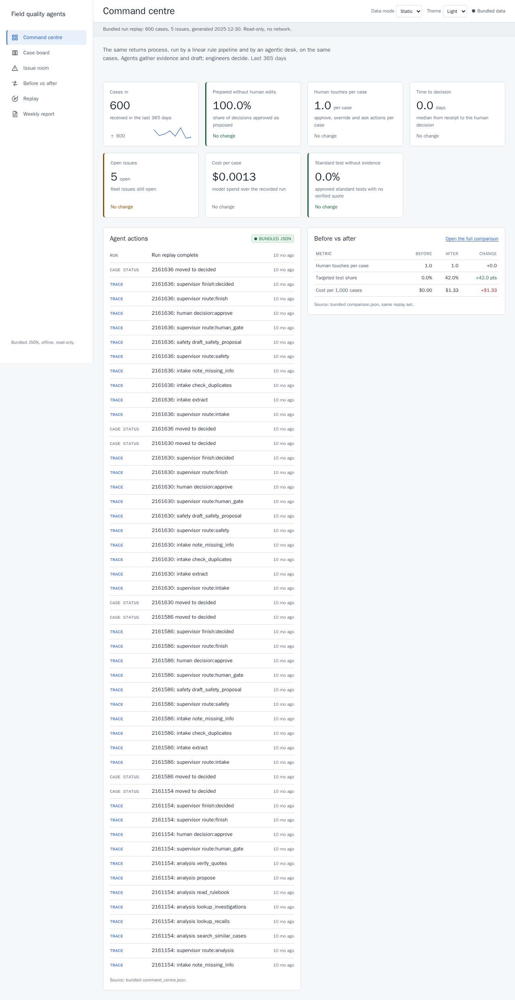
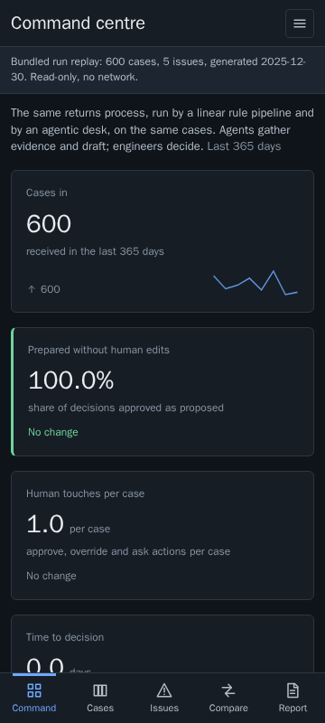
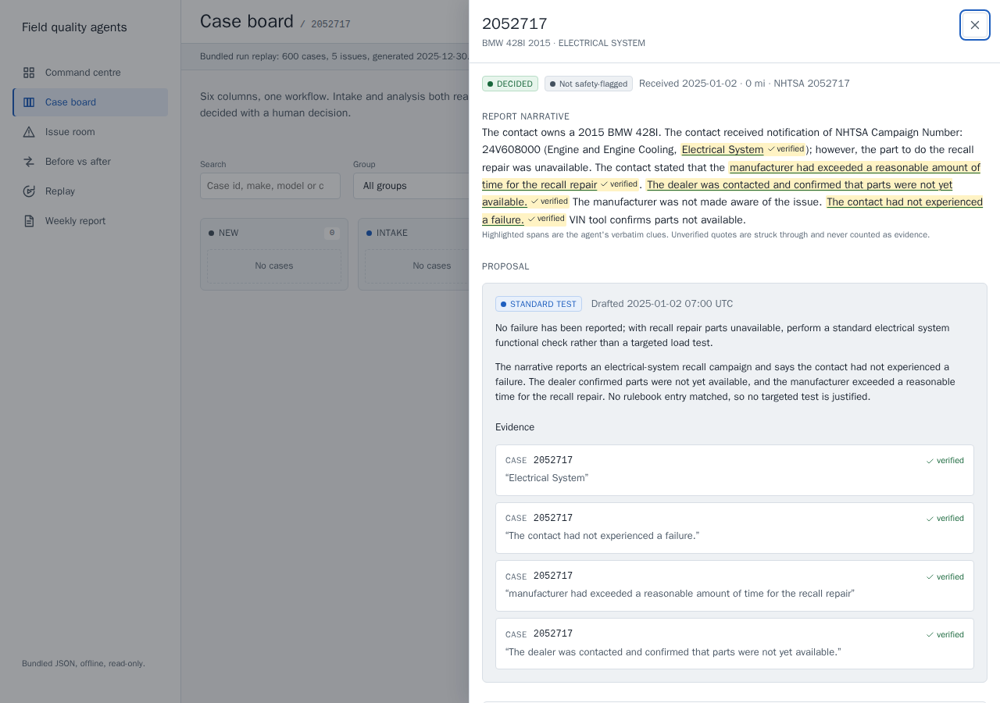
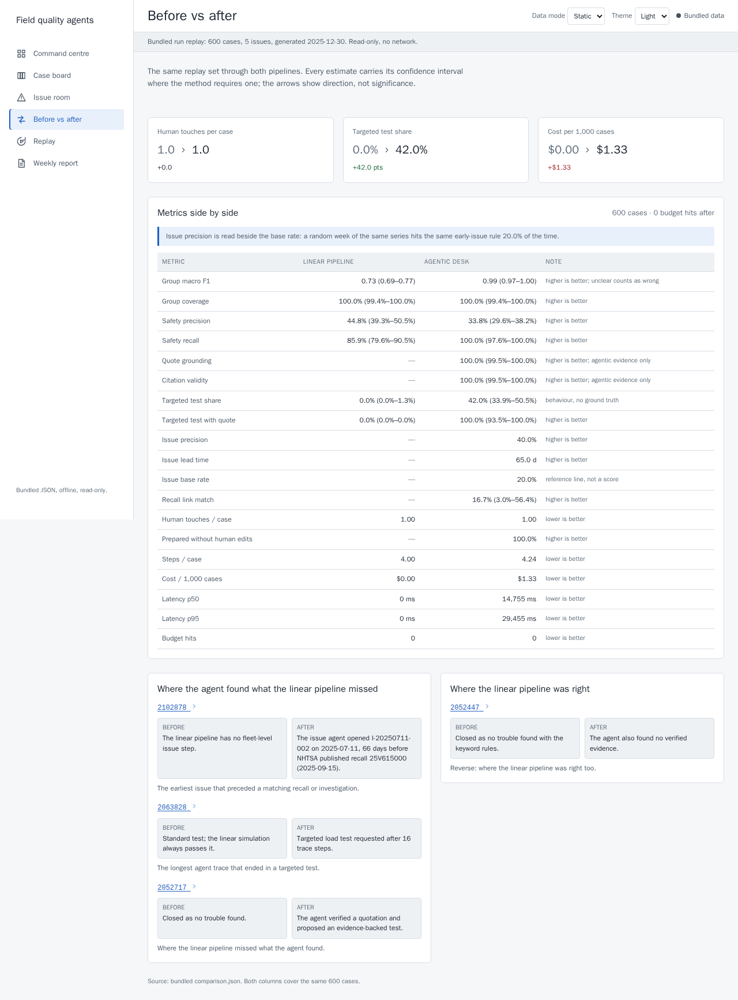

# Field Quality Agents

> **The plain question:** *What happens when a returns pipeline becomes agentic:
> same process, agents doing the legwork between the steps, engineers approving?*

[Explore the project and recorded evidence](https://sabersojudi.com/field-quality-agents/)
· [Source code](https://github.com/sabers13/field-quality-agents)

A supplier receives far more returned electrical and electronic parts and
complaint reports than its labs and engineers can analyse properly. Many parts
get a standard test, find nothing ("no trouble found"), and go back without a
root cause. The cost is warranty money accepted without evidence, fleet-wide
problems seen late, and audit pressure.

This project builds **both pipelines on the same real data** and shows them side
by side:

- **Before:** a linear, rule-based pipeline. Register, sort with keyword rules,
  run the standard test, close.
- **After:** an agentic desk. A supervisor routes each report to agents (intake,
  analysis, issue, report) that use tools, gather evidence, draft documents and
  stop at human checkpoints.

Agents never close a case, scrap a part, return a part or accept a charge. Every
action is in a trace, and every number on the dashboard comes from a committed
file under `results/`.

## Quickstart

You need Python 3.12, [uv](https://docs.astral.sh/uv/) and Node 22.12 or newer.
From a local checkout:

```bash
make setup    # Python and dashboard dependencies
make all      # data check, baseline, replay run, dashboard data, web build
make serve    # http://127.0.0.1:8000
```

`make all` needs no model key and no network: it replays the committed
recordings, rebuilds `results/runs/replay/` and writes
`results/MANIFEST.sha256`, which records the hash of every reproducible output.
Run it twice and the manifest is byte-identical.

`make serve` starts the replay dashboard with real recorded data. Live mode
(`uv run fqa serve --mode live`) is the mode an engineer uses on new reports; it
makes model calls and is documented in `METHOD.md`. To check the whole project:

```bash
make release-check
```

## Headline numbers

Both pipelines processed the same `replay_2025` set. Scoring is deterministic:
no model grades a model. The metrics files carry the confidence intervals and
the method behind them.

Before values are from `results/baseline/metrics.json`; after values are from
`results/runs/replay/metrics.json`. An em dash means the row has no number:
either the linear pipeline has no equivalent measurement, or the agentic run
did not produce a valid one (see the note below the table).

| Metric | Before: linear pipeline | After: agentic desk |
|---|---:|---:|
| Component group macro-F1 | 0.7340 | — |
| Safety recall | 0.8590 | — |
| Safety precision | 0.4482 | — |
| Targeted load test share | 0.0000 | **0.4198** |
| Targeted test with a verified quote | — | **0.5636** |
| Quote grounding | — | **0.9064** |
| Citation validity | — | **1.0000** |
| Issue precision | — | 0.4000 |
| Issue base rate (random weeks) | — | 0.2000 |
| Issue median lead time (days) | — | 65 |
| Recall link match | — | 0.1667 |
| Human touches per case | 1.00 | 1.00 |
| Decided without edits | — | 1.0000 |
| Steps per case | 4.00 | 4.26 |
| Budget hits | 0 | 0 |
| Cost per 1,000 cases (USD) | 0.00 | 1.33 |
| Latency p50 (seconds) | — | 14.8 |
| Latency p95 (seconds) | — | 29.5 |

Read the table as behaviour, not as a scoreboard. An em dash on the agentic
side means the run did not produce a valid measurement. The independent review
found that two NHTSA truth fields — the component group and the safety flag —
were visible to the model in the recorded run, so its group and safety numbers
measured a copy of the answer key rather than the desk (`reports/REVIEW.md` B1
and B2). The desk no longer sends either field to the model, and the two rows
stay blank until the final live run measures them on unseen reports; the
recorded run's other rows — evidence, workload, issue detection and cost — do
not depend on those fields. As recorded, the desk flagged **462** reports
against **156** in the NHTSA fields, and only **146** reports reached the
analysis agent. Issue detection reports 0.4000 precision against a 0.2000 base
rate for random weeks, with a median lead time of 65 days, and recall linking
is thin at 0.1667 (1 of 6 linked recalls matching on make, model, year and
group).

## The run at a glance

The recorded run `live-2025` played **600 reports** through the agentic desk;
`make all` replays the same turns offline.

- **Work:** **600 decisions**, all by the simulated engineer, and **0 budget hits**.
  Traces hold **6,683** steps; the desk spent **2,556** budget steps, 4.26 per
  case.
- **Fleet view:** **5 fleet issues** and **53 weekly reports**.
- **Spend:** **USD 0.798998** at gateway list cost, about **1.33** per 1,000
  cases. `reports/RUN.md` records the timing and the two attempts.
- **Routing:** **462** reports were flagged safety-relevant, against **156** in
  the NHTSA crash, fire, injury or death fields. **146** reports reached the
  analysis agent, **13** asked the reporter for more information, and **55**
  proposals requested a targeted load test.
- **Before:** the linear pipeline sent **299** reports to a priority queue and
  closed **301** as no trouble found, because its simulated standard test always
  passes.
- **Evidence:** the desk proposed **4,166** quotes, kept them only when they
  were verbatim, and dropped **27**; **90.64%** of the proposed quotes are
  grounded. **736** citations name a case, recall or investigation that exists.

Sources: `results/runs/replay/manifest.json`, `results/runs/replay/metrics.json`,
`results/runs/replay/decisions.json`, `results/runs/replay/proposals.json`,
`results/runs/replay/traces.json`, `results/runs/replay/issues.json`,
`results/runs/replay/reports.json` and `results/runs/replay/report.json`.
`reports/RUN.md` is the narrative account.

## What the desk found

The first fleet issue, `I-20250217-001`, was opened on 2025-02-17 after adas
reports for the FISKER OCEAN 2023 clustered at 36 in a week against a threshold
of 17. It links two reports and NHTSA investigation PE24013, and it has an 8D
D1–D4 draft and a one-page decision memo. The issue agent's numbers come from
`results/runs/replay/issues.json`; the drafts from `eight_d.json` and
`memos.json` in the same directory.

The fixed comparison examples are in
`results/runs/replay/comparison_examples.json`:

| Case | Linear pipeline | Agentic desk |
|---|---|---|
| `2065213` | No fleet-level issue step exists. | The issue agent opened `I-20250217-001`. |
| `2156317` | Standard test; the simulation always passes. | Targeted test requested after 16 trace steps. |
| `2052717` | Closed as no trouble found. | Verified evidence found; a targeted test was proposed. |
| `2052447` | Closed as no trouble found. | The agent also found no verified evidence. |

The last row matters as much as the third: the point is not that agents always
find something, it is that the trace shows why they did or did not.

## Screenshots

The original seven operational pages were captured at 360 and 1280 px in light
and dark into `results/screenshots/` with Playwright. These captures preserve the
original release; the portfolio link above opens the redesigned overview and
current controls.

| Command centre, 1280 px | Command centre, 360 px dark |
|---|---|
|  |  |
| **Case detail, 1280 px** | **Before vs after, 1280 px** |
|  |  |

## The dashboard

| Page | What it shows |
|---|---|
| **Project overview** | The problem, a real report, verified evidence, measured limits and links into the working desk. |
| **Command centre** | KPI tiles, a live feed of agent actions and a before/after summary. |
| **Case board** | Reports by status, with a search and filter. |
| **Case detail** | The narrative with highlighted quotes, the full agent trace, the proposal, similar cases, linked recalls and the approve / override / ask controls. |
| **Issue room** | The cluster chart with the spike rule, linked recalls and investigations, the 8D D1–D4 draft, the decision memo and clickable citations. |
| **Before vs after** | The PLAN §7 metrics side by side, plus the comparison examples above. |
| **Replay** | A recorded run played day by day: reports arriving, agents acting, humans deciding. |
| **Weekly report** | The report agent's weekly quality report. |

Three modes share one interface: **replay** (the default, served from
`results/runs/`), **live** (the same desk on new reports, with a person at the
buttons) and a **static export** under `dist/field-quality-agents/` that opens
offline with bundled JSON.

The same tool functions are also exposed over MCP with `uv run fqa mcp`, so an
MCP client can call the search, lookup, quote-check and rulebook tools directly.

## Limits

Be clear about what this is:

1. **US vehicle data stands in for supplier returns.** The reports are public
   NHTSA owner complaints, recalls and investigations, used as incoming reports
   and as ground truth. They are not a supplier's return records, and the
   makes, models and components are the vehicle world's, not a factory's.
2. **The engineer is simulated in the batch run.** The batch engineer is a
   deterministic rule set: it approves when quotes verify and no hard rule is
   broken. All 600 decisions were approvals, so "decided without edits" is
   1.0000 by construction. It measures the rule, not a person. In live mode a
   person makes the decision.
3. **The rulebook is an example.** `config/rulebook.toml` maps a handful of
   reported conditions to targeted tests. It is readable and editable, not a
   service manual, and it is not tuned per vehicle.
4. **The group and safety measurements are open.** The independent review found
   the component-group label and the NHTSA safety flag in the model input of the
   recorded run (`reports/REVIEW.md` B1 and B2). The desk no longer sends either
   field to the model, and the two rows that depend on them are blank rather
   than published from a contaminated run; the final live run measures them on
   unseen reports. As recorded, 462 reports were flagged against 156 in the
   NHTSA fields, and only 146 reports reach the analysis agent. Nothing was
   tuned after seeing the replay set.
5. **Names are not screened.** The PII screen covers VINs, e-mail addresses,
   phone numbers and street addresses, not personal names in a narrative
   signature. Publication retains the original public NHTSA records under the
   owner's scoped decision in `reports/DEVIATIONS.md`; review B4 remains a
   limitation of the screen, not a claim of complete anonymisation.
6. **One model and one prompt version.** The run used a single model and prompt
   version. Costs are gateway list prices, not a negotiated rate.
7. **The comparison is a simulation.** "Time to decision" and the linear
   pipeline's four steps are modelled, not observed in a real factory. The
   workload comparison is about shape, not a measured saving.

## Repository map

| Path | Contents |
|---|---|
| `data/` | Committed derived parquet files, the snapshot record, groups and `STATS.md`. |
| `recordings/` | Every model turn from the live run, keyed by model, prompt version, messages and tools. |
| `results/` | Both pipelines' metrics, decisions, traces, issues, 8D drafts, memos, weekly reports and the reproducibility manifest. |
| `src/field_quality_agents/` | Data build, tools, baseline, agents, metrics, API, CLI and MCP server. |
| `web/` | React + TypeScript dashboard (Vite, ECharts). |
| `config/` | Keyword rules, example rulebook, budgets, prices and the forbidden-name hashes. |
| `scripts/` | Data check, facts check, scanners and the results manifest. |
| `tests/` | Offline unit, integration and Playwright tests. |
| `docs/` | Verified notes on the model, LangGraph, MCP and DuckDB, plus the interfaces. |
| `reports/` | `RUN.md` and the lane reports. |

## Documents

- `METHOD.md` — the method in plain words: architecture, agents, data,
  dashboard, metrics and reproducibility.
- `THIRD_PARTY.md` — data sources, licences and every software dependency.
- `CHANGELOG.md` — what is in this version and what changed.
- `project-facts.yml` — the canonical numbers, each with the committed file it
  comes from; `make facts` re-derives them.
- `reports/RUN.md` — the live run: spend, timing, steps, deviations and what
  went wrong.

## Licence and credits

The project is MIT licensed; see `LICENSE`. NHTSA data is public information;
the licence statement and every dependency's licence are in `THIRD_PARTY.md`.
The model is DeepSeek V4.1 Flash through an OpenAI-compatible gateway; the key
is read only from the file named by `FQA_ENV_FILE` and never appears in this
repository, a log, a trace or a recording.
